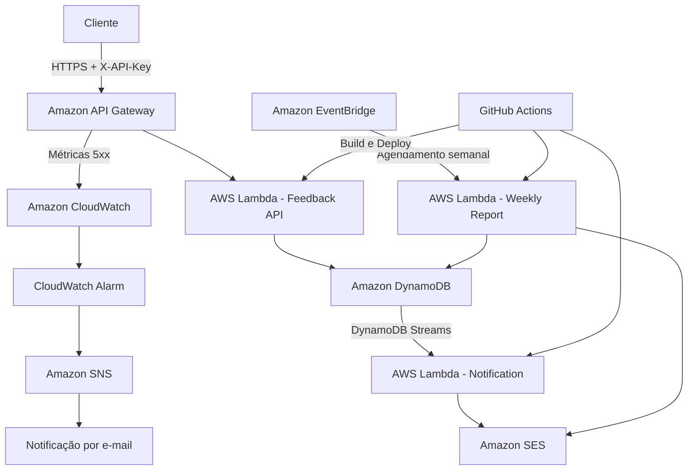

# FIAP Tech Challenge — Fase 4

Sistema serverless de gerenciamento de avaliações de atendimento, desenvolvido com Java 21 e serviços AWS.

## 1. Visão geral

O projeto tem como objetivo receber e armazenar avaliações de atendimento, identificar automaticamente sua urgência, notificar os responsáveis sobre avaliações críticas e gerar relatórios semanais com indicadores e detalhamento das avaliações recebidas.

A solução utiliza uma arquitetura baseada em serviços gerenciados da AWS, com funções serverless, persistência NoSQL, processamento orientado a eventos e automação de deploy.

## 2. Arquitetura

A aplicação é composta por três módulos independentes:

- **Feedback API:** recebe, valida e consulta avaliações.
- **Notification Function:** processa eventos do DynamoDB Streams e envia notificações de avaliações críticas.
- **Weekly Report Function:** gera e envia relatórios semanais automaticamente.

### Diagrama da arquitetura



## 3. Tecnologias utilizadas

### Desenvolvimento

- Java 21
- Spring Boot
- Maven
- AWS SDK for Java 2.x

### Serviços AWS

- AWS Lambda
- Amazon API Gateway (HTTP API)
- Amazon DynamoDB
- DynamoDB Streams
- Amazon EventBridge
- Amazon SES
- Amazon CloudWatch
- Amazon SNS
- AWS IAM
- Amazon S3
- AWS SAM

### CI/CD

- GitHub Actions

## 4. Estrutura do projeto

```text
fiap-techchallenge-fase4/
│
├── feedback-api/
│   └── src/
│
├── notification-function/
│   └── src/
│
├── weekly-report-function/
│   └── src/
│
├── infrastructure/
│   ├── template.yaml
│   ├── feedback-api-template.yaml
│   └── weekly-report-template.yaml
│
├── .github/
│   └── workflows/
│       └── deploy.yml
│
└── README.md
```

Cada módulo possui seu próprio projeto Maven e pode ser compilado independentemente.

## 5. Funcionalidades

### 5.1 Feedback API

API REST desenvolvida com Spring Boot e executada em AWS Lambda, disponibilizada por meio do Amazon API Gateway.

Endpoints:

| Método | Endpoint | Descrição |
|---|---|---|
| POST | `/avaliacoes` | Cadastra uma avaliação |
| GET | `/avaliacoes` | Lista as avaliações |
| GET | `/avaliacoes/teste-erro-500` | Endpoint de teste de monitoramento |

#### Cadastro de avaliação

Exemplo de requisição:

```json
{
  "descricao": "Excelente atendimento",
  "nota": 9
}
```

A API valida os dados recebidos e determina automaticamente a urgência da avaliação:

| Nota | Urgência |
|---|---|
| 0 a 4 | CRITICA |
| 5 a 6 | MEDIA |
| 7 a 10 | BAIXA |

Cada avaliação recebe um identificador único e informações de data e horário de envio.

Os dados são armazenados no Amazon DynamoDB.

### 5.2 Notificações de avaliações críticas

A aplicação utiliza DynamoDB Streams para identificar novas avaliações inseridas na tabela.

Uma função AWS Lambda processa os eventos de inserção e verifica a urgência da avaliação.

Quando uma avaliação é classificada como `CRITICA`, uma notificação por e-mail é enviada utilizando o Amazon SES.

O processamento é realizado de forma assíncrona, desacoplando o cadastro das avaliações do envio das notificações.

### 5.3 Relatório semanal

Uma função AWS Lambda gera automaticamente um relatório semanal com informações das avaliações recebidas nos últimos sete dias.

O processamento consulta o índice secundário global do DynamoDB e consolida os dados.

O relatório contempla:

- Descrição de cada avaliação;
- Nota individual;
- Urgência;
- Data e horário de envio;
- Quantidade de avaliações por dia;
- Quantidade de avaliações por urgência;
- Total de avaliações;
- Média das notas.

O relatório é enviado por e-mail utilizando o Amazon SES.

O agendamento é realizado pelo Amazon EventBridge:

- Frequência: semanal;
- Dia: segunda-feira;
- Horário: 12h UTC (9h no horário de Brasília).

## 6. Segurança

A solução utiliza diferentes mecanismos de segurança:

### Autenticação da API

Todos os endpoints da Feedback API exigem uma chave de acesso enviada no cabeçalho HTTP:

```http
X-API-Key: SUA_CHAVE
```

A validação é realizada por um filtro Spring Boot, que compara a chave recebida com a chave configurada no ambiente da Lambda.

Requisições sem chave ou com chave inválida recebem:

```http
HTTP 401 Unauthorized
```

### Controle de acesso IAM

As funções Lambda utilizam roles específicas, com permissões limitadas aos recursos necessários para cada operação.

Exemplos:

- Feedback API: acesso à tabela DynamoDB;
- Notification Function: leitura do DynamoDB Streams e envio de e-mails pelo SES;
- Weekly Report Function: consulta ao índice do DynamoDB e envio de e-mails pelo SES.

### Proteção dos dados

- Comunicação HTTPS por meio do Amazon API Gateway;
- Criptografia em repouso do Amazon DynamoDB;
- Segredos e credenciais armazenados no GitHub Secrets;
- Bloqueio de acesso público ao bucket de artefatos S3;
- Controle de permissões por meio do AWS IAM.

## 7. Monitoramento e alertas

O projeto utiliza Amazon CloudWatch para monitorar erros HTTP 5xx da API.

Foi configurado um alarme com as seguintes características:

| Configuração | Valor |
|---|---|
| Métrica | AWS/ApiGateway — 5xx |
| API | Feedback API |
| Período | 60 segundos |
| Limite | 1 ocorrência |
| Condição | Maior ou igual a 1 |

Quando a condição é atingida, o CloudWatch Alarm envia uma notificação para um tópico Amazon SNS.

O SNS encaminha o alerta por e-mail aos responsáveis.

O endpoint `/avaliacoes/teste-erro-500` permite validar o funcionamento do monitoramento de forma controlada.

## 8. CI/CD — GitHub Actions

O projeto possui um workflow de integração e entrega contínuas utilizando GitHub Actions.

O pipeline é executado automaticamente em atualizações na branch `main` e também pode ser iniciado manualmente.

Etapas do pipeline:

1. Checkout do repositório;
2. Configuração do Java 21;
3. Configuração das credenciais AWS;
4. Configuração do AWS SAM;
5. Build dos módulos;
6. Deploy da Feedback API;
7. Deploy da Notification Function;
8. Deploy da Weekly Report Function.

As credenciais e a chave de autenticação da API são armazenadas como GitHub Repository Secrets.

## 9. Configuração e execução

### Pré-requisitos

- Java 21;
- Maven;
- AWS CLI;
- AWS SAM CLI;
- Conta AWS configurada;
- Credenciais com permissões necessárias para os recursos do projeto.

### Configuração AWS

Configure a região AWS utilizada pelo projeto:

```powershell
$env:AWS_PROFILE = "fiap-dev"
$env:AWS_REGION = "us-east-2"
```

### Compilação dos módulos

Feedback API:

```powershell
cd feedback-api
mvn clean package
```

Notification Function:

```powershell
cd notification-function
mvn clean package
```

Weekly Report Function:

```powershell
cd weekly-report-function
mvn clean package
```

### Build com AWS SAM

Exemplo para a Feedback API:

```powershell
sam build --template-file infrastructure/feedback-api-template.yaml
```

O deploy dos recursos é realizado pelo workflow do GitHub Actions.

## 10. Endpoints publicados

Base URL:

```text
https://ns7thjib48.execute-api.us-east-2.amazonaws.com
```

Todos os endpoints exigem o cabeçalho `X-API-Key`.

### Consultar avaliações

```http
GET /avaliacoes
```

### Cadastrar avaliação

```http
POST /avaliacoes
Content-Type: application/json
X-API-Key: SUA_CHAVE
```

Exemplo:

```json
{
  "descricao": "Excelente atendimento",
  "nota": 9
}
```

### Testar monitoramento

```http
GET /avaliacoes/teste-erro-500
X-API-Key: SUA_CHAVE
```

O endpoint retorna intencionalmente HTTP 500 para validar o alarme do CloudWatch.

## 11. Considerações finais

O projeto demonstra a utilização de uma arquitetura serverless na AWS para processamento e gerenciamento de avaliações de atendimento.

A solução contempla persistência de dados, processamento assíncrono, notificações automáticas, relatórios periódicos, controle de acesso, monitoramento e automação de implantação.

O uso de serviços gerenciados permite reduzir a necessidade de infraestrutura dedicada e facilita a escalabilidade e manutenção da aplicação.

---

**FIAP Tech Challenge — Fase 4**  
Desenvolvido como projeto acadêmico.